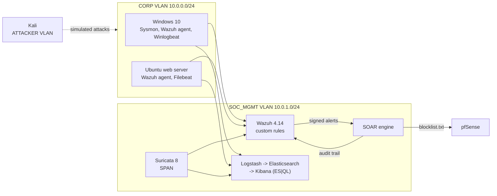

# SOC Home Lab: Detection-as-Code

[](https://github.com/omaralraas/SOC-home-lab/actions/workflows/ci.yml)


A segmented SOC lab (pfSense, Wazuh, Suricata, Elastic and a custom SOAR engine) built as
**detection-as-code**: every detection rule, engine config and threat hunt in this repository is
tested against the real engine in CI before it can merge.

| | |
|---|---|
| **Detections** | 33 Wazuh rules, 22 Suricata signatures, 13 Sigma rules, 12 YARA rules, mapped to 40 ATT&CK techniques |
| **Tests** | 75 Wazuh event replays on analysisd 4.14, 34 generated PCAPs on Suricata 8, 60 Sigma test events, 31 YARA samples, 18 ES\|QL hunts on Elasticsearch, full-stack end-to-end run |
| **Automation** | HMAC-authenticated SOAR webhook with an expiring pfSense blocklist and a SIEM-audited action trail |
| **Docs generated from the rules** | [Detection catalog](docs/detection-catalog.md) (Splunk / Elastic / Defender XDR queries) and [ATT&CK coverage](docs/mitre-coverage.md) with a Navigator layer |

---

## Architecture



Details: [architecture.md](docs/architecture.md) · Deployment: [setup-guide.md](docs/setup-guide.md)

---

## What CI checks on every commit

```mermaid
flowchart LR
    PR[Pull request] --> L[Lint: ruff, sigma check,<br/>shellcheck, compose]
    PR --> W[Wazuh: rules replayed on<br/>real analysisd + rule-tree lint]
    PR --> S[Suricata: generated PCAPs<br/>on Suricata 8]
    PR --> U[Sigma + YARA + tools<br/>unit tests]
    PR --> E[ES|QL hunts on<br/>Elasticsearch 9.5]
    E --> X[End-to-end: full Elastic<br/>stack fed by Beats + Suricata]
    PR --> D[Generated docs<br/>must be current]
```

| Layer | How it is tested |
|---|---|
| **Wazuh** | Boots `wazuh-manager` with this repo's `ossec.conf`, rules and `agent.conf`; replays YAML cases through `wazuh-logtest` and asserts the rule that fires, including thresholds and correlation windows. Fails on any rule-load warning, and a lint models the stock rule tree to catch custom rules that silently disable stock correlation. |
| **Suricata** | scapy builds complete TCP sessions (with hand-encoded TLS and SMB2); Suricata replays each PCAP with the lab config and the test asserts the exact set of SIDs, including tuning suppressions. |
| **Sigma** | A small evaluator walks pySigma's parsed condition tree, so each rule is checked against true positives *and* benign look-alikes, then compiled to Splunk SPL, Elastic ES\|QL and Defender XDR KQL. |
| **YARA** | Compiled with warnings as errors; samples are assembled in memory so endpoint AV never quarantines the test corpus. |
| **Elastic** | Every ES\|QL hunt runs on a seeded Elasticsearch and must surface its planted activity; the e2e job brings up the real compose stack and ships logs through Filebeat and a genuine Suricata `eve.json`. |
| **Python tools** | Unit tests with coverage for the log analysers, beacon hunter and SOAR engine. |

### Findings that only testing against real engines exposed

- **Wazuh files each event in sid-based *or* group-based correlation lists, never both.** One
  `if_matched_sid` on a stock rule silently disabled stock rule 60204 (Windows brute force).
- **The stock "success after brute force" rule never sees remote Windows logons**, because
  `if_group` only attaches to rules loaded earlier; custom rule 100102 fills the gap.
- **Suricata thresholds count packets, not connections**, and `smb.named_pipe` holds the IPC$
  tree path rather than the pipe name, so two signatures had to be redesigned.
- **YARA `fullword` on `"eval("` misses `eval(gzinflate(...))`**, and a single unreferenced
  string had kept a whole rule file from ever compiling.

The full list, with root causes: [detection-engineering.md](docs/detection-engineering.md).

---

## Detection content

| Engine | Content | Highlights |
|---|---|---|
| **Wazuh** ([rules](wazuh/rules)) | 33 custom rules | Password spraying, lockout storms, compromise after brute force, PowerShell cradles and encoded commands, LSASS dumping (comsvcs / ProcDump / mimikatz), Defender tampering, ransomware file-write bursts, lateral movement from both source and target (PsExec, WMI, WinRM, pass-the-hash) |
| **Suricata** ([rules](suricata/rules)) | 22 signatures | DNS tunnelling and TXT C2, Stratum mining, SQLi, port scans, OpenSSL-default TLS certs, PsExec over SMB2, admin shares from untrusted VLANs |
| **Sigma** ([rules](detection-rules/sigma)) | 13 rules | Portable versions for Windows, Linux and DNS logs; [compiled per SIEM](docs/detection-catalog.md) |
| **YARA** ([rules](detection-rules/yara)) | 12 rules | Web shells (PHP/ASPX/JSP, China Chopper), reverse shells, loaders, credential-store dumps, ransomware |
| **Hunting** ([ES\|QL](scripts/threat-hunting/esql)) | 18 hunts | Stacking for persistence, time-bucket correlation for lateral movement, DNS tunnelling, upload ratios, periodic connections |
| **Beacon hunter** ([script](scripts/threat-hunting/beacon_hunter.py)) | Python | Scores Suricata flows for C2 beaconing with median/MAD jitter, size consistency and persistence |

Response: [SOAR engine](scripts/automation/soar_engine.py) · [Wazuh integration](wazuh/integrations) ·
[IR playbooks](docs/playbooks) · [pfSense policy](network/firewall-rules/pfsense-rules.conf)

---

## Run it

```bash
git clone https://github.com/omaralraas/SOC-home-lab.git && cd SOC-home-lab
pip install -r requirements-dev.txt

pytest -m "not docker"   # Sigma, YARA, tools: seconds, no Docker needed
pytest                   # + Wazuh, Suricata and Elasticsearch containers
pytest -m e2e            # full Elastic stack end to end (about 3 GB RAM)

python -m tools.convert_sigma      # regenerate the multi-SIEM detection catalog
python -m tools.attack_coverage    # regenerate ATT&CK coverage + Navigator layer
```

Deploying the lab (VMs, pfSense, agents) is covered step by step in the
[setup guide](docs/setup-guide.md); each tier is a `docker compose up` once the VMs exist.

---

## Repository layout

```
.github/workflows/ci.yml       detection-as-code pipeline
wazuh/                         compose stack, ossec.conf, centralized agent.conf,
                               custom rules, SOAR integration
suricata/                      overlay config, tuning, custom signatures, sensor compose
elastic/                       compose stack, setup job, Logstash pipelines, Beats configs
detection-rules/sigma|yara/    portable detections
scripts/automation/            SOAR engine (Flask + gunicorn container)
scripts/log-analysis/          SSH auth-log and Windows Security log triage tools
scripts/threat-hunting/        ES|QL hunts and the beacon hunter
tools/                         Sigma evaluator, SIEM compiler, ATT&CK coverage generator
tests/                         one suite per engine (see "What CI checks")
docs/                          architecture, setup, detection engineering, coverage,
                               catalog, playbooks, lessons learned
network/                       pfSense policy
```

---

## Skills demonstrated

| Area | Where |
|---|---|
| Detection engineering | Rules across four engines with true-positive and benign test cases, tuning against stock rulesets |
| SIEM internals | Wazuh rule-tree and correlation semantics, analysisd test harness, rule-tree lint |
| Network security monitoring | Suricata 8 app-layer keywords, threshold semantics, PCAP-driven regression tests |
| Threat hunting | Hypothesis-driven ES\|QL hunts, statistical beacon detection |
| Security automation | Signed webhooks, least-privilege service accounts, safe-by-default containment |
| Log engineering | ECS normalisation in Logstash, data streams, lifecycle policies, Beats |
| DevSecOps | CI against real engines, SHA-pinned actions, pinned dependencies, Dependabot |
| Incident response | NIST-aligned playbooks tied to concrete rule IDs and hunts |

---

## License

MIT, see [LICENSE](LICENSE).

<p align="center">Built by <a href="https://github.com/omaralraas">Omar Alraas</a></p>
