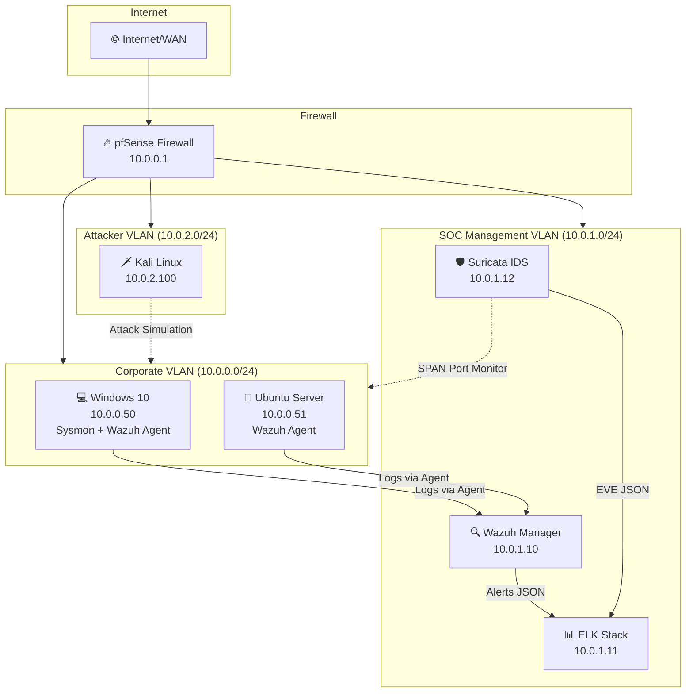

# 🛡️ SOC Home Lab — Security Operations Center Environment


A **fully functional Security Operations Center** built from scratch using open-source tools. This project demonstrates hands-on blue team skills including SIEM deployment, intrusion detection, detection engineering, threat hunting, incident response, and security automation.

---

## 📋 Overview

This home lab simulates a realistic enterprise SOC environment with:

- **Network segmentation** using pfSense with VLANs (Corporate, SOC Management, Attacker)
- **Centralized SIEM** (Wazuh) with custom detection rules and active response
- **Log management** (ELK Stack) with enrichment pipelines and dashboards
- **Network IDS** (Suricata) with custom threat detection signatures
- **Detection engineering** with Sigma, YARA, and custom Wazuh rules
- **Automated response** with a lightweight SOAR engine
- **Attack simulation** and detection validation against MITRE ATT&CK

---

## 🏗️ Lab Architecture



### Data Flow
```
Endpoints → Wazuh Agents → Wazuh Manager → Logstash → Elasticsearch → Kibana
                                              ↑
Network Traffic → Suricata IDS → EVE JSON ────┘
```

---

## 🛠️ Technologies Used

| Component | Tool | Purpose |
|-----------|------|---------|
| Firewall | pfSense | Network segmentation & traffic control |
| SIEM | Wazuh 4.7 | Security event management & alerting |
| Search & Analytics | Elasticsearch 8.12 | Log storage & search |
| Log Pipeline | Logstash | Log parsing, enrichment & normalization |
| Dashboards | Kibana | Visualization & investigation |
| Network IDS | Suricata 7.0 | Network traffic analysis & threat detection |
| Endpoint Monitoring | Sysmon | Detailed Windows event logging |
| Detection Rules | Sigma / YARA | Standardized detection signatures |
| Attack Simulation | Kali Linux | Red team testing & validation |
| Automation | Custom SOAR (Python) | Alert enrichment & automated response |

---

## ⭐ Key Features

- 🔍 **30+ Custom Detection Rules** — Wazuh rules for brute force, lateral movement, credential theft, and ransomware
- 🌐 **13 Suricata IDS Signatures** — C2 beaconing, DNS tunneling, port scanning, SQL injection
- 📝 **5 Sigma Rules** — Cross-platform detection for persistence, credential access, defense evasion
- 🧬 **8 YARA Rules** — Ransomware, web shells, reverse shells, obfuscated scripts
- 📊 **3 Logstash Pipelines** — Syslog, Windows events, Suricata with MITRE ATT&CK enrichment
- 🤖 **SOAR Automation** — Auto IP blocking, threat intel enrichment, Slack notifications
- 📋 **3 IR Playbooks** — Malware infection, brute force, and ransomware response
- 🎯 **Threat Hunting Queries** — KQL queries for persistence, lateral movement, and exfiltration
- 📈 **MITRE ATT&CK Mapping** — Coverage matrix with gap analysis

---

## 📁 Project Structure

```
SOC-home-lab/
├── 📄 README.md
├── 📄 LICENSE
├── 📂 docs/
│   ├── architecture.md              # Network topology & data flow
│   ├── setup-guide.md               # Step-by-step deployment guide
│   ├── lessons-learned.md           # Project reflections & challenges
│   ├── mitre-coverage.md            # ATT&CK coverage matrix
│   └── playbooks/                   # Incident response playbooks
│       ├── IR-001-malware-infection.md
│       ├── IR-002-brute-force-attack.md
│       └── IR-003-ransomware.md
├── 📂 wazuh/
│   ├── docker-compose.yml           # Wazuh deployment
│   ├── ossec.conf                   # Manager configuration
│   ├── rules/                       # Custom detection rules
│   └── decoders/                    # Custom log decoders
├── 📂 elastic/
│   ├── docker-compose.yml           # ELK Stack deployment
│   ├── elasticsearch/               # ES configuration
│   ├── kibana/                      # Kibana configuration
│   └── logstash/                    # Log pipelines
│       └── pipeline/
│           ├── syslog.conf
│           ├── windows-events.conf
│           └── suricata.conf
├── 📂 suricata/
│   ├── suricata.yaml                # IDS configuration
│   └── rules/                       # Custom IDS rules
├── 📂 detection-rules/
│   ├── sigma/                       # Sigma detection rules
│   │   ├── windows/
│   │   ├── linux/
│   │   └── network/
│   └── yara/                        # YARA malware rules
├── 📂 scripts/
│   ├── log-analysis/                # Python analysis tools
│   │   ├── log_analyzer.py
│   │   └── windows_event_parser.py
│   ├── threat-hunting/              # KQL hunting queries
│   └── automation/                  # SOAR engine
│       └── soar_engine.py
└── 📂 network/
    └── firewall-rules/              # pfSense configuration
```

---

## 🚀 Getting Started

See the full [Setup Guide](docs/setup-guide.md) for detailed deployment instructions.

### Quick Start
```bash
# Clone the repository
git clone https://github.com/omaralraas/SOC-home-lab.git
cd SOC-home-lab

# Deploy Wazuh SIEM
cd wazuh && docker-compose up -d

# Deploy ELK Stack
cd ../elastic && cp .env.example .env && docker-compose up -d
```

---

## 🎯 Skills Demonstrated

| Skill Area | Details |
|------------|---------|
| **SIEM Deployment & Management** | Wazuh installation, agent enrollment, rule tuning |
| **Detection Engineering** | Custom Wazuh, Sigma, YARA, and Suricata rules |
| **Log Analysis & Correlation** | Logstash pipelines, KQL queries, event correlation |
| **Incident Response** | Structured IR playbooks with NIST framework alignment |
| **Threat Hunting** | Proactive KQL-based hunting across multiple data sources |
| **Network Security Monitoring** | Suricata IDS with custom signatures and PCAP analysis |
| **Security Automation** | Python SOAR engine with API integrations |
| **Network Segmentation** | VLAN design, firewall rules, defense-in-depth architecture |
| **MITRE ATT&CK Framework** | Detection mapping, coverage analysis, gap remediation |

---

## 📚 Documentation

- [Architecture Overview](docs/architecture.md) — Network topology, VLAN design, data flow
- [Setup Guide](docs/setup-guide.md) — Complete deployment instructions
- [MITRE ATT&CK Coverage](docs/mitre-coverage.md) — Detection coverage matrix
- [Lessons Learned](docs/lessons-learned.md) — Challenges, solutions, and takeaways
- [IR Playbooks](docs/playbooks/) — Incident response procedures

---

## 📄 License

This project is licensed under the MIT License — see the [LICENSE](LICENSE) file for details.

---

<p align="center">
  Built with 🔐 by <a href="https://github.com/omaralraas">Omar Alraas</a>
</p>
