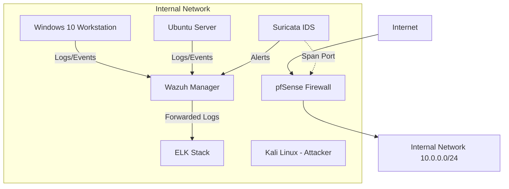

# SOC Home Lab — Security Operations Center Environment


## Overview
This is a fully functional SOC home lab built from scratch for hands-on blue team security experience. The environment simulates a real-world enterprise network, complete with a firewall, IDS, SIEM, log management, and multiple endpoints for simulating attacks and practicing detection, threat hunting, and incident response.

## Lab Architecture



## Technologies Used

| Component | Tool | Purpose |
| --- | --- | --- |
| Firewall/Router | pfSense | Network segmentation, firewall rules, routing |
| SIEM | Wazuh | Log collection, SIEM, file integrity monitoring, active response |
| Log Management | Elasticsearch, Logstash, Kibana (ELK) | Log storage, indexing, data visualization, dashboarding |
| IDS | Suricata | Network intrusion detection system |
| Endpoint Agent | Sysmon | Advanced Windows event logging |
| Attack Simulation | Atomic Red Team | Simulating MITRE ATT&CK techniques |
| Rule Definition | Sigma | Generic signature format for SIEM systems |
| Malware Analysis | YARA | Identifying and classifying malware samples |

## Key Features
- **Real-time threat detection:** Active monitoring and alerting based on suspicious activities.
- **Custom SIEM rules:** Tailored rules for specific threat scenarios (brute force, malware, etc.).
- **Network intrusion detection:** Deep packet inspection for malicious network traffic.
- **Log aggregation and analysis:** Centralized log management for easy searching and visualization.
- **Threat hunting capabilities:** Environment setup for proactive threat hunting exercises.
- **Incident response automation:** Active response scripts for containing threats automatically.
- **Attack simulation and detection validation:** Using Atomic Red Team to test and validate detection logic.

## Project Structure
```
SOC-home-lab/
├── docs/               # Documentation
├── network/            # Network configs
├── wazuh/              # Wazuh configs, rules, decoders
├── elastic/            # ELK Stack configurations
├── scripts/            # Automation scripts
├── README.md           # This file
├── LICENSE             # Project license
└── .gitignore          # Git ignore rules
```

## Getting Started
Please refer to the [Setup Guide](docs/setup-guide.md) to start building the lab environment.

## Skills Demonstrated
- SIEM deployment & management
- IDS/IPS configuration
- Log analysis & correlation
- Detection engineering
- Incident response
- Threat hunting
- Network security monitoring
- Malware analysis fundamentals

---
**Built with:** ❤️ for Blue Teaming  
**License:** [MIT License](LICENSE)
