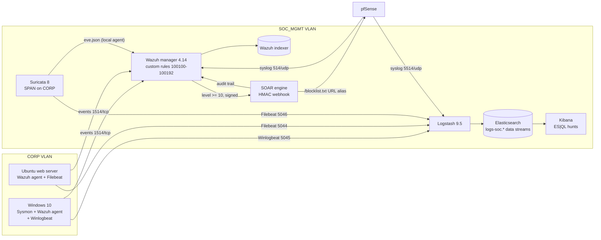

# Network Architecture

## Overview
This document details the network topology, VLAN segmentation, and data flow architecture of the SOC Home Lab environment. The lab simulates a realistic enterprise network with proper security zones, monitoring capabilities, and network segmentation.

## Network Topology

```
+-------------------------------------------------------------------------+
|                           INTERNET (WAN)                                |
+--------------------------------+----------------------------------------+
                                 |
                    +------------+------------+
                    |    pfSense Firewall     |
                    |    WAN: DHCP            |
                    |    LAN: 10.0.0.1/24     |
                    |    MGMT: 10.0.1.1/24    |
                    |    ATK: 10.0.2.1/24     |
                    +--------+---+---+--------+
                             |   |   |
              +--------------+   |   +--------------+
              |                  |                   |
   +----------+----------+  +---+-----------+  +----+-------------+
   |   SOC MGMT VLAN     |  |  CORP VLAN    |  |  ATTACKER VLAN   |
   |   10.0.1.0/24       |  |  10.0.0.0/24  |  |  10.0.2.0/24     |
   |                     |  |               |  |                   |
   | +------------------+|  | +-----------+ |  | +--------------+  |
   | | Wazuh Manager    ||  | | Win10     | |  | | Kali Linux   |  |
   | | 10.0.1.10        ||  | | 10.0.0.50 | |  | | 10.0.2.100   |  |
   | +------------------+|  | +-----------+ |  | +--------------+  |
   | +------------------+|  | +-----------+ |  |                   |
   | | ELK Stack        ||  | | Ubuntu    | |  +-------------------+
   | | 10.0.1.11        ||  | | 10.0.0.51 | |
   | +------------------+|  | +-----------+ |
   | +------------------+|  |               |
   | | Suricata IDS     ||  +---------------+
   | | 10.0.1.12        ||
   | +------------------+|
   +----------------------+
```

## IP Address Assignments

| Host | IP Address | VLAN | OS | Role |
|------|-----------|------|-----|------|
| pfSense | 10.0.0.1 / 10.0.1.1 / 10.0.2.1 | All | FreeBSD | Gateway/Firewall |
| Wazuh + SOAR | 10.0.1.10 | SOC_MGMT | Ubuntu 24.04 | Wazuh manager/indexer/dashboard 4.14 and the SOAR engine (Docker) |
| Elastic | 10.0.1.11 | SOC_MGMT | Ubuntu 24.04 | Elasticsearch, Logstash, Kibana 9.5 (Docker) |
| Suricata IDS | 10.0.1.12 | SOC_MGMT | Ubuntu 24.04 | Suricata 8 on the CORP SPAN port (Docker) |
| Windows 10 | 10.0.0.50 | CORP | Windows 10 Pro | Endpoint (victim) |
| Ubuntu Server | 10.0.0.51 | CORP | Ubuntu 22.04 | Web Server (victim) |
| Kali Linux | 10.0.2.100 | ATTACKER | Kali 2024.1 | Attack simulation |

## VLAN Configuration

| VLAN ID | Name | Subnet | Purpose | Inter-VLAN Policy |
|---------|------|--------|---------|-------------------|
| 10 | CORP | 10.0.0.0/24 | Corporate endpoints | Restricted outbound |
| 20 | SOC_MGMT | 10.0.1.0/24 | Security monitoring | Full visibility |
| 30 | ATTACKER | 10.0.2.0/24 | Isolated attack zone, outside Suricata HOME_NET | CORP access only |

## Data Flow Architecture

Two analytics paths share the same sources. Wazuh does real-time correlation and alerting;
the Elastic tier keeps normalised ECS data for ES|QL hunting. The SOAR engine closes the loop
back to the firewall, and its own actions are fed back into Wazuh as audit events.



| Path | Transport | Parsing / detection |
|---|---|---|
| Windows host -> Wazuh | Agent (Security, System, Sysmon, PowerShell, Defender channels from `shared/agent.conf`) | Stock Windows/Sysmon rules + custom 1001xx rules |
| Linux host -> Wazuh | Agent (auth.log, Apache, FIM on /etc and /var/www) | Stock sshd/web rules + custom brute-force rules |
| Suricata -> Wazuh | Agent on the sensor reading eve.json | Stock Suricata rules (86600+) |
| Wazuh -> SOAR | `custom-soar` integration, HMAC-SHA256 signed | Playbook: block, notify, recommend account disable |
| SOAR -> pfSense | pfSense URL-table alias polls `/blocklist.txt` | Block rules on WAN, ATTACKER and CORP egress |
| SOAR -> Wazuh | JSON audit lines on a shared volume | Rules 100190-100192 (failed actions alert) |
| Beats / syslog -> Elastic | Logstash pipelines -> `logs-soc.{windows,syslog,suricata}-lab` | ECS normalisation, ATT&CK enrichment, ES|QL hunts |

## Hardware Requirements

| Component | Minimum | Recommended |
|-----------|---------|-------------|
| CPU | 8 cores (Intel i7/Ryzen 7) | 16 cores (Intel i9/Ryzen 9) |
| RAM | 16 GB DDR4 | 32 GB DDR4 |
| Storage | 100 GB SSD | 256 GB NVMe SSD |
| Network | 1 Gigabit NIC | 2+ Gigabit NICs |
| Hypervisor | VirtualBox 7.0 | VMware Workstation Pro |

## Monitoring Ports

| Service | Port | Direction | Purpose |
|---|---|---|---|
| Wazuh agent | 1514/tcp | CORP -> 10.0.1.10 | Agent events |
| Wazuh enrollment | 1515/tcp | CORP -> 10.0.1.10 | Agent registration (password required) |
| Wazuh syslog | 514/udp | pfSense -> 10.0.1.10 | Firewall logs |
| Wazuh API | 55000/tcp | SOC only | Dashboard -> manager |
| Wazuh dashboard | 443/tcp | Analyst -> 10.0.1.10 | Alert triage |
| SOAR | 5000/tcp | Manager / pfSense -> 10.0.1.10 | Webhook, `/blocklist.txt`, `/health` |
| Logstash Beats | 5044 / 5045 / 5046 tcp | Hosts -> 10.0.1.11 | Filebeat (Linux), Winlogbeat, Filebeat (Suricata) |
| Logstash syslog | 5514/udp+tcp | pfSense -> 10.0.1.11 | Firewall logs |
| Elasticsearch | 9201/tcp | SOC only | REST / ES|QL (9200 stays free for the Wazuh indexer) |
| Kibana | 5601/tcp | Analyst -> 10.0.1.11 | Hunting |
| Suricata | - | Passive | SPAN of the CORP VLAN |

## VM Resource Allocation

| VM | vCPUs | RAM | Disk | Network Adapters |
|----|-------|-----|------|-----------------|
| pfSense | 1 | 1 GB | 10 GB | 4 (WAN, CORP, SOC, ATK) |
| Wazuh Manager | 2 | 4 GB | 50 GB | 1 (SOC_MGMT) |
| ELK Stack | 4 | 8 GB | 100 GB | 1 (SOC_MGMT) |
| Suricata | 2 | 2 GB | 20 GB | 2 (SOC_MGMT + SPAN) |
| Windows 10 | 2 | 4 GB | 50 GB | 1 (CORP) |
| Ubuntu Server | 1 | 2 GB | 20 GB | 1 (CORP) |
| Kali Linux | 2 | 4 GB | 40 GB | 1 (ATTACKER) |
