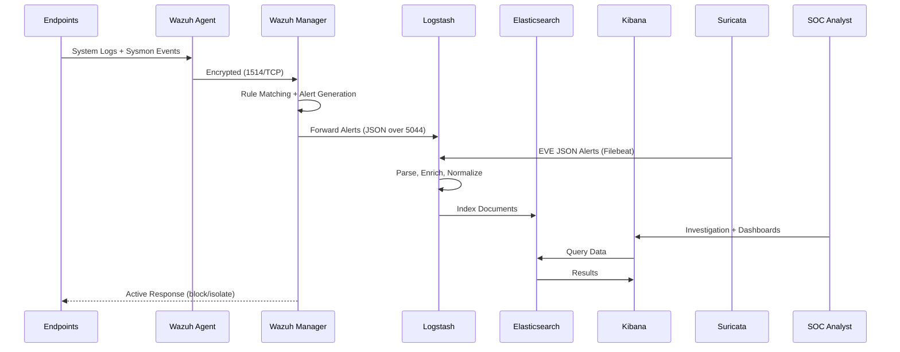

# Network Architecture

## Overview
This document details the network topology, VLAN segmentation, and data flow architecture of the SOC Home Lab environment. The lab simulates a realistic enterprise network with proper security zones, monitoring capabilities, and network segmentation.

## Network Topology

```
+-------------------------------------------------------------------------+
|                           INTERNET (WAN)                                |
+--------------------------------+----------------------------------------+
                                 |
                    +------------+------------+
                    |    pfSense Firewall     |
                    |    WAN: DHCP            |
                    |    LAN: 10.0.0.1/24     |
                    |    MGMT: 10.0.1.1/24    |
                    |    ATK: 10.0.2.1/24     |
                    +--------+---+---+--------+
                             |   |   |
              +--------------+   |   +--------------+
              |                  |                   |
   +----------+----------+  +---+-----------+  +----+-------------+
   |   SOC MGMT VLAN     |  |  CORP VLAN    |  |  ATTACKER VLAN   |
   |   10.0.1.0/24       |  |  10.0.0.0/24  |  |  10.0.2.0/24     |
   |                     |  |               |  |                   |
   | +------------------+|  | +-----------+ |  | +--------------+  |
   | | Wazuh Manager    ||  | | Win10     | |  | | Kali Linux   |  |
   | | 10.0.1.10        ||  | | 10.0.0.50 | |  | | 10.0.2.100   |  |
   | +------------------+|  | +-----------+ |  | +--------------+  |
   | +------------------+|  | +-----------+ |  |                   |
   | | ELK Stack        ||  | | Ubuntu    | |  +-------------------+
   | | 10.0.1.11        ||  | | 10.0.0.51 | |
   | +------------------+|  | +-----------+ |
   | +------------------+|  |               |
   | | Suricata IDS     ||  +---------------+
   | | 10.0.1.12        ||
   | +------------------+|
   +----------------------+
```

## IP Address Assignments

| Host | IP Address | VLAN | OS | Role |
|------|-----------|------|-----|------|
| pfSense | 10.0.0.1 / 10.0.1.1 / 10.0.2.1 | All | FreeBSD | Gateway/Firewall |
| Wazuh Manager | 10.0.1.10 | SOC_MGMT | Ubuntu 22.04 | SIEM Manager |
| ELK Stack | 10.0.1.11 | SOC_MGMT | Ubuntu 22.04 | Log Management |
| Suricata IDS | 10.0.1.12 | SOC_MGMT | Ubuntu 22.04 | Network IDS |
| Windows 10 | 10.0.0.50 | CORP | Windows 10 Pro | Endpoint (victim) |
| Ubuntu Server | 10.0.0.51 | CORP | Ubuntu 22.04 | Web Server (victim) |
| Kali Linux | 10.0.2.100 | ATTACKER | Kali 2024.1 | Attack simulation |

## VLAN Configuration

| VLAN ID | Name | Subnet | Purpose | Inter-VLAN Policy |
|---------|------|--------|---------|-------------------|
| 10 | CORP | 10.0.0.0/24 | Corporate endpoints | Restricted outbound |
| 20 | SOC_MGMT | 10.0.1.0/24 | Security monitoring | Full visibility |
| 30 | ATTACKER | 10.0.2.0/24 | Isolated attack zone | CORP access only |

## Data Flow Architecture



## Hardware Requirements

| Component | Minimum | Recommended |
|-----------|---------|-------------|
| CPU | 8 cores (Intel i7/Ryzen 7) | 16 cores (Intel i9/Ryzen 9) |
| RAM | 16 GB DDR4 | 32 GB DDR4 |
| Storage | 100 GB SSD | 256 GB NVMe SSD |
| Network | 1 Gigabit NIC | 2+ Gigabit NICs |
| Hypervisor | VirtualBox 7.0 | VMware Workstation Pro |

## Monitoring Ports

| Service | Port | Protocol | Direction | Purpose |
|---------|------|----------|-----------|---------|
| Wazuh Agent | 1514 | TCP | Agent -> Manager | Agent communication |
| Wazuh Registration | 1515 | TCP | Agent -> Manager | Agent enrollment |
| Wazuh API | 55000 | TCP | Dashboard -> Manager | Management API |
| Elasticsearch | 9200 | TCP | Internal | REST API |
| Kibana | 5601 | TCP | Analyst -> Kibana | Web dashboard |
| Logstash Beats | 5044 | TCP | Agents -> Logstash | Beats input |
| Logstash Syslog | 5514 | UDP/TCP | Network -> Logstash | Syslog input |
| Suricata | - | - | Passive | SPAN port monitoring |

## VM Resource Allocation

| VM | vCPUs | RAM | Disk | Network Adapters |
|----|-------|-----|------|-----------------|
| pfSense | 1 | 1 GB | 10 GB | 4 (WAN, CORP, SOC, ATK) |
| Wazuh Manager | 2 | 4 GB | 50 GB | 1 (SOC_MGMT) |
| ELK Stack | 4 | 8 GB | 100 GB | 1 (SOC_MGMT) |
| Suricata | 2 | 2 GB | 20 GB | 2 (SOC_MGMT + SPAN) |
| Windows 10 | 2 | 4 GB | 50 GB | 1 (CORP) |
| Ubuntu Server | 1 | 2 GB | 20 GB | 1 (CORP) |
| Kali Linux | 2 | 4 GB | 40 GB | 1 (ATTACKER) |
