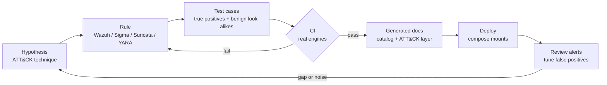

# Detection Engineering

How detections in this repo are written, tested and shipped, and the engine behaviours that
testing against the real engines uncovered. Everything here runs in CI
([`.github/workflows/ci.yml`](../.github/workflows/ci.yml)); nothing is validated by eye.

## Lifecycle

1. **Start from behaviour, not a keyword.** Each rule names the technique and the specific
   artefact it keys on (a command line, an event sequence, a protocol field).
2. **Check stock coverage first.** Wazuh ships ~4,500 rules; several planned rules were dropped
   because the stock ruleset already alerts (certutil downloads 92075, LSASS access 92900,
   executables dropped in Temp 92213). Those become `[stock]` regression tests instead.
3. **Write a true positive and a benign look-alike** that sits as close to the detection logic as
   possible: Defender being *re-enabled*, Google's "Update" scheduled task, ProcDump of a
   non-LSASS process, a 44-character DNS label against a 45-character threshold.
4. **Run it on the real engine.** Rule syntax checkers miss most of the bugs listed below.
5. **Regenerate docs.** The [detection catalog](detection-catalog.md) and
   [ATT&CK coverage](mitre-coverage.md) are generated from the rules; CI fails if they drift.

## How each engine is tested

| Engine | Test harness | What it proves |
|---|---|---|
| Wazuh 4.14 | `tests/wazuh`: boots `wazuh-manager` with the repo's `ossec.conf`, rules and `agent.conf` mounted exactly as compose does; replays YAML cases through the `wazuh-logtest` socket | The rule that fires on each event or event sequence (thresholds, correlation windows), that analysisd loads the ruleset without warnings, `wazuh-analysisd -t` and `verify-agent-conf` pass |
| Wazuh (static) | `tests/wazuh/test_ruleset_lint.py`: replays rule load order and sid/group marking over the 4,512 stock rules | No custom rule silently hides events from stock correlation rules (see below) |
| Sigma | `tools/sigma_engine.py` evaluates pySigma's parsed condition tree against JSON events; `sigma check --fail-on-issues` | Each rule matches its true positives and none of its benign events; ATT&CK v20 tags valid |
| Suricata 8 | `tests/suricata`: scapy builds 36 PCAPs (full TCP sessions, hand-encoded TLS and SMB2); Suricata replays each with the lab overlay | The exact set of lab SIDs per scenario, including suppressions from `threshold.config` |
| YARA | `tests/yara`: compiled with warnings as errors; samples assembled in memory | Each sample matches exactly its expected rules; no slow regexes or unreferenced strings |
| ES\|QL hunts | `tests/elastic`: seeded Elasticsearch 9.5; full compose stack in the `e2e` job | Every hunt parses, its fields exist, and it surfaces the activity planted for it |

## Engine behaviours worth knowing

These were all found by tests failing against the real engines, and each one invalidated a
detection that looked correct on paper.

### Wazuh

**An event feeds either `if_matched_sid` or `if_matched_group` correlation, never both.**
After matching, analysisd files the event in the sid list of its final rule if any rule
references that rule with `if_matched_sid`; only otherwise does it go to group lists
(`analysisd.c`, "Copy the structure to the state memory of if_matched_sid"). A custom
`if_matched_sid 60122` (Windows logon failure) therefore *disabled* stock rule 60204 (multiple
Windows logon failures), which counts the same events through `if_matched_group`. No error, no
warning; the brute-force alert simply stopped. The lint in `test_ruleset_lint.py` now catches
this class of bug for every custom rule.

**Group-based correlation on SSH failures does not work at all with the stock ruleset.** Stock
rules 5763 and 5712 already use `if_matched_sid` on 5760/5710, so SSH failure events never reach
group lists. A "count all SSH failure types together" rule cannot be built with
`if_matched_group authentication_failed`; this repo relies on the stock brute-force rules instead.

**`if_group` attaches only to rules loaded earlier.** Stock 40112 ("authentication success after
failures") is loaded from `0040-*.xml`, before the remote-logon rules 92651/92652 in
`0840-*.xml`, so it never sees remote Windows logons. Custom rule 100102 fills that gap.

**First match wins, and level-0 grouping rules are tried first.** Under 61603 (Sysmon process
creation) the stock grouping rules 92025, 92028, 92042 and 92069 are evaluated before everything
else, and once a parent matches its siblings are never tried. A custom rule attached only to
61603 never sees PowerShell running a script (92028) or anything spawned by WmiPrvSE (92069), so
process-creation rules are attached to all five parents.

**Production EventChannel values keep doubled backslashes** (`C:\\Windows\\...`), as Wazuh's own
ruleset tests show. Test events are generated the same way, and path separators in rules are
matched with `\\+`.

**`wazuh-logtest` cannot reach the built-in EventChannel decoder** (it always submits through the
localfile queue). The harness loads a test-only decoder of the same name that JSON-decodes the
post-decoding `{"win": ...}` structure, the same workaround Wazuh's `runtests.py` uses.

### Suricata

- **Thresholds count matching packets, not connections.** A "5 connections to a non-standard
  port" rule matching `flow:established` fired on a single chatty session. Connection-count rules
  now match the SYN.
- **`smb.named_pipe` holds the IPC$ tree path**, not the pipe being opened; the PsExec rule
  matches the UTF-16 `PSEXESVC` name in the SMB2 CREATE instead.
- **Suricata has no `arp` rule protocol.** One such rule made the whole file fail to load.
- **`HOME_NET` must exclude the attacker VLAN**, or every `$EXTERNAL_NET -> $HOME_NET` rule is
  blind to the lab's own attack simulations.

### YARA

- **An unreferenced string is a hard compile error**, so one stray `$password` meant an entire
  rule file had never loaded.
- **`fullword` on `"eval("` fails when the argument starts with a letter** (`eval(gzinflate(`),
  because the character after the match must be non-alphanumeric. Call sinks use
  `/\beval\s*\(/` instead, which keeps a literal atom so it stays fast.

### Sigma, Elastic and Logstash

- ATT&CK v20 split Defense Evasion into **Stealth** and **Defense Impairment** and moved
  T1562.001 to **T1685**; `sigma check` rejects the old IDs.
- pySigma processing pipelines **rename fields on the rule object in place**, so a rule must be
  re-parsed per backend or Splunk field names leak into the ES|QL and KQL output.
- **Kibana 8+ refuses to start with `xpack.security.enabled`** in `kibana.yml`.
- Winlogbeat 8+ maps Security/Sysmon events to ECS in **Elasticsearch ingest pipelines**, so
  Logstash has to forward `[@metadata][pipeline]`.
- Logstash reports a pipeline healthy slightly **before the UDP syslog input is bound**; UDP sent
  into that window is lost, so the e2e test resends until events land.

## Adding a detection

1. Write the rule in the right engine folder, with ATT&CK mapping and false-positive notes.
2. Add test cases:
   - Wazuh: `tests/wazuh/cases/*.yml` (`expect` / `expect_not`), or a reviewed entry in `untested.yml`
   - Sigma: `tests/sigma/cases/*.yml` keyed by rule id (needs a match and a non-match)
   - Suricata: a scenario in `tests/suricata/scenarios.py` declaring its exact SIDs
   - YARA: a sample in `tests/yara/samples.yml`
3. `python -m tools.convert_sigma && python -m tools.attack_coverage` to regenerate docs.
4. `pytest` (add `-m e2e` for the full Elastic stack), then open a PR. CI must be green.
5. After deploying, review the rule's alert volume and false positives, and tune with
   documented exceptions (Wazuh child rules at level 0, Sigma `filter_*` selections, Suricata
   `threshold.config` suppressions).
