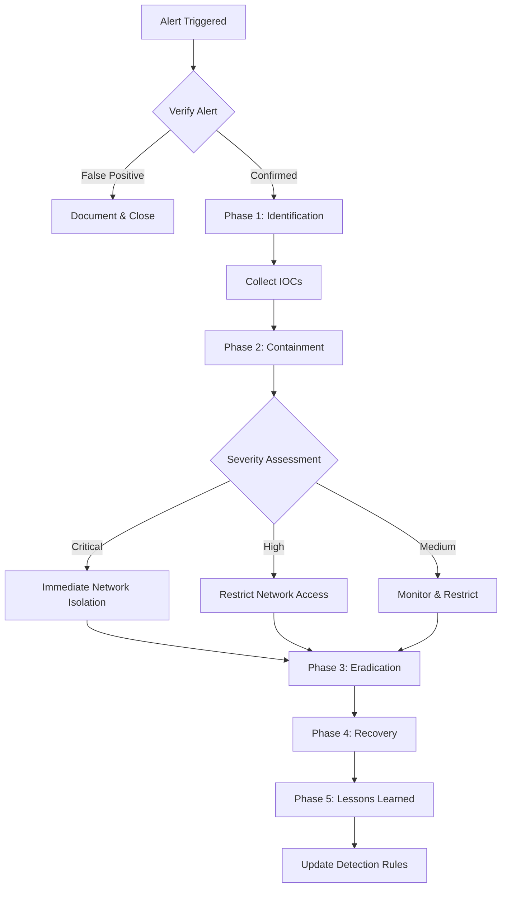

# IR-001: Malware Infection Response Playbook

| Field | Value |
|-------|-------|
| **Playbook ID** | IR-001 |
| **Title** | Malware Infection Response |
| **Severity** | High |
| **Author** | Omar Alraas |
| **Last Updated** | 2025-02-01 |
| **MITRE ATT&CK** | T1204 (User Execution), T1059 (Command Interpreter), T1486 (Impact) |

## Objective
Contain, eradicate, and recover from a confirmed or suspected malware infection on a network endpoint while preserving forensic evidence.

## Detection Sources
- Wazuh alerts: Rules 100120-100128 (suspicious activity detection)
- Suricata IDS: C2 beaconing, suspicious outbound connections
- YARA: File-based malware signature matches
- Endpoint AV/EDR alerts

## Response Flow



## Phase 1: Identification (0-30 minutes)

### 1.1 Alert Triage
- [ ] Review the triggering alert in Wazuh/Kibana dashboard
- [ ] Determine the affected host(s) and user account(s)
- [ ] Identify the malware type (trojan, ransomware, worm, etc.)
- [ ] Check for lateral movement indicators

### 1.2 IOC Collection
- [ ] Record file hashes (MD5, SHA256) of suspicious files
- [ ] Document C2 IP addresses and domains
- [ ] Capture process tree and parent-child relationships
- [ ] Screenshot relevant dashboard alerts
- [ ] Record timeline of events

### 1.3 Scope Assessment
- [ ] Query Wazuh for other agents with similar IOCs
- [ ] Search Suricata logs for C2 communication from other hosts
- [ ] Check for the malware hash across all endpoints

## Phase 2: Containment (30-60 minutes)

### 2.1 Short-term Containment
- [ ] Isolate affected host from network (Wazuh active response or manual)
  ```bash
  # Wazuh active response - block host
  /var/ossec/active-response/bin/firewall-drop.sh add - <INFECTED_IP>
  ```
- [ ] Disable compromised user accounts
- [ ] Block C2 IPs/domains at pfSense firewall
  ```
  # Add to pfSense alias blocklist
  C2_IP -> Block on WAN/LAN interfaces
  ```
- [ ] Preserve volatile evidence (memory dump if possible)

### 2.2 Long-term Containment
- [ ] Create forensic disk image before remediation
- [ ] Apply emergency firewall rules to restrict lateral movement
- [ ] Increase monitoring on potentially affected systems

## Phase 3: Eradication (1-4 hours)

- [ ] Remove malware files and persistence mechanisms
- [ ] Clean registry keys, scheduled tasks, and services
- [ ] Verify removal with full AV scan
- [ ] Patch the vulnerability that allowed initial infection
- [ ] Reset credentials for affected accounts

## Phase 4: Recovery (4-24 hours)

- [ ] Restore system from known-good backup (if available)
- [ ] Gradually restore network connectivity
- [ ] Monitor for re-infection indicators (24-48 hour watch)
- [ ] Verify system functionality and services
- [ ] Update YARA rules and Wazuh detection signatures

## Phase 5: Lessons Learned (Post-incident)

- [ ] Conduct post-incident review within 5 business days
- [ ] Document root cause and attack vector
- [ ] Update this playbook with findings
- [ ] Create new detection rules for the attack pattern
- [ ] Share IOCs with threat intelligence community (if appropriate)

## Escalation Matrix

| Severity | Escalate To | Timeframe |
|----------|------------|-----------|
| Critical | SOC Manager + IT Director | Immediate |
| High | SOC Manager | Within 30 min |
| Medium | Senior Analyst | Within 2 hours |
| Low | Document and monitor | Next business day |
