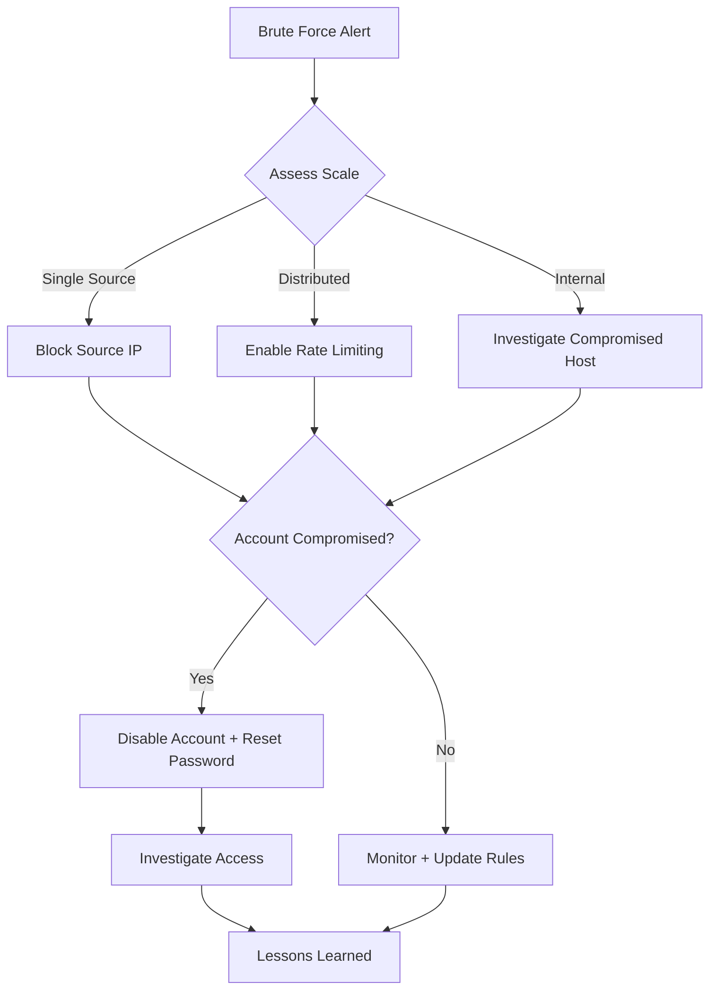

# IR-002: Brute Force Attack Response Playbook

| Field | Value |
|-------|-------|
| **Playbook ID** | IR-002 |
| **Title** | Brute Force Attack Response |
| **Severity** | Medium - Critical |
| **Author** | Omar Alraas |
| **Last Updated** | 2025-02-01 |
| **MITRE ATT&CK** | T1110 (Brute Force), T1078 (Valid Accounts) |

## Objective
Detect, block, and remediate brute force attacks against authentication services (SSH, RDP, Web) while determining if any accounts were compromised.

## Detection Sources
- Wazuh rules: 100100-100108 (custom brute force rules)
- Suricata: Port scan detection rules
- ELK: Failed logon event correlation

## Response Flow



## Phase 1: Identification

### 1.1 Alert Analysis
- [ ] Identify source IP(s) of the brute force attempt
- [ ] Determine targeted service (SSH, RDP, Web application)
- [ ] Count total failed attempts and timeframe
- [ ] Identify targeted user accounts

### 1.2 Check for Compromise
```kql
# KQL - Check for successful login after failures from same IP
winlog.event_id:4624 AND source.ip:<ATTACKER_IP>
AND @timestamp > "<ATTACK_START_TIME>"
```
- [ ] Search for successful logins from the attacking IP(s)
- [ ] Review any post-authentication activity from compromised accounts

## Phase 2: Containment

### 2.1 Block Attacker
- [ ] Add source IP to pfSense blocklist
- [ ] Activate Wazuh active response (auto-block via rules 100100-100102)
  ```xml
  <!-- Wazuh active response triggers automatically -->
  <!-- Manual block if needed: -->
  iptables -I INPUT -s <ATTACKER_IP> -j DROP
  ```
- [ ] If distributed attack, enable account lockout policies
- [ ] If internal source, isolate the compromised host

### 2.2 Protect Accounts
- [ ] Lock targeted accounts temporarily
- [ ] Force password reset for any potentially compromised accounts
- [ ] Enable MFA if not already active

## Phase 3: Eradication
- [ ] Verify IP block is effective (check logs for continued attempts)
- [ ] If account was compromised, revoke all active sessions
- [ ] Audit account activity during compromise window
- [ ] Remove any persistence mechanisms if attacker gained access

## Phase 4: Recovery
- [ ] Unlock accounts after password reset
- [ ] Monitor for continued attack from different sources
- [ ] Update firewall and IDS rules with new threat indicators
- [ ] Implement additional brute force protections (fail2ban, rate limiting)

## Phase 5: Lessons Learned
- [ ] Was the attack automated or targeted?
- [ ] Were default/weak credentials used?
- [ ] Should authentication policies be strengthened?
- [ ] Update brute force detection thresholds if needed
