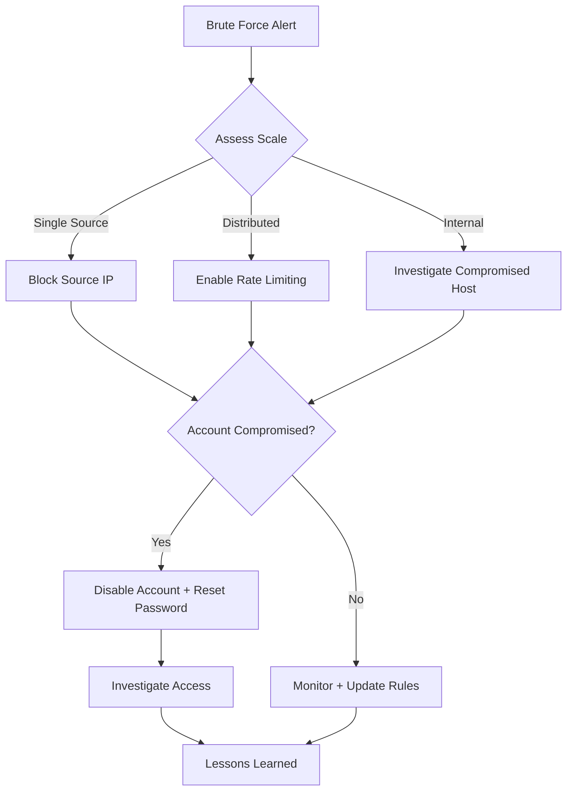

# IR-002: Brute Force Attack Response Playbook

| Field | Value |
|-------|-------|
| **Playbook ID** | IR-002 |
| **Title** | Brute Force Attack Response |
| **Severity** | Medium - Critical |
| **Author** | Omar Alraas |
| **Last Updated** | 2026-10-25 |
| **MITRE ATT&CK** | T1110 (Brute Force), T1078 (Valid Accounts) |

## Objective
Detect, block, and remediate brute force attacks against authentication services (SSH, RDP, Web) while determining if any accounts were compromised.

## Detection Sources
- Wazuh stock rules: 5712 / 5763 (SSH brute force), 60204 (Windows logon failures), 40112 (SSH
  success after failures)
- Wazuh custom rules: 100100 (password spraying), 100101 (lockout storm), 100102 (remote logon
  after a Windows brute force), 100103 (root SSH login), 100104 (web login brute force)
- Suricata: Port scan detection rules
- ELK: Failed logon event correlation

## Response Flow



## Phase 1: Identification

### 1.1 Alert Analysis
- [ ] Identify source IP(s) of the brute force attempt
- [ ] Determine targeted service (SSH, RDP, Web application)
- [ ] Count total failed attempts and timeframe
- [ ] Identify targeted user accounts

### 1.2 Check for Compromise
```esql
FROM logs-soc.windows-*, logs-soc.syslog-*
| WHERE source.ip == "<ATTACKER_IP>" AND @timestamp > "<ATTACK_START_TIME>"
    AND (event.code == "4624" OR event.outcome == "success")
| KEEP @timestamp, host.name, user.name, winlog.event_data.TargetUserName, event.code, event.outcome
| SORT @timestamp
```
Over longer ranges, run the "SSH sources that failed and then succeeded" and "Password spraying"
hunts in [credential_access_hunting.md](../../scripts/threat-hunting/esql/credential_access_hunting.md).
- [ ] Search for successful logins from the attacking IP(s)
- [ ] Review any post-authentication activity from compromised accounts

## Phase 2: Containment

### 2.1 Block Attacker
- [ ] Confirm automatic containment fired:
  - Wazuh active response `firewall-drop` (rules 5712, 5763, 100104) or `netsh` (60204, 100100)
    blocks the source on the targeted host for 1 hour
  - The SOAR engine adds the source to the pfSense `SOAR_BLOCKLIST` alias
    (`curl http://10.0.1.10:5000/blocklist.txt`); its audit events are Wazuh rules 100190-100192,
    and 100191 means the action failed
- [ ] If automation did not fire, block manually at pfSense (the source of truth for perimeter blocks)
- [ ] If distributed attack, enable account lockout policies
- [ ] If internal source, isolate the compromised host

### 2.2 Protect Accounts
- [ ] Lock targeted accounts temporarily
- [ ] Force password reset for any potentially compromised accounts
- [ ] Enable MFA if not already active

## Phase 3: Eradication
- [ ] Verify IP block is effective (check logs for continued attempts)
- [ ] If account was compromised, revoke all active sessions
- [ ] Audit account activity during compromise window
- [ ] Remove any persistence mechanisms if attacker gained access

## Phase 4: Recovery
- [ ] Unlock accounts after password reset
- [ ] Monitor for continued attack from different sources
- [ ] Update firewall and IDS rules with new threat indicators
- [ ] Implement additional brute force protections (fail2ban, rate limiting)

## Phase 5: Lessons Learned
- [ ] Was the attack automated or targeted?
- [ ] Were default/weak credentials used?
- [ ] Should authentication policies be strengthened?
- [ ] Update brute force detection thresholds if needed
