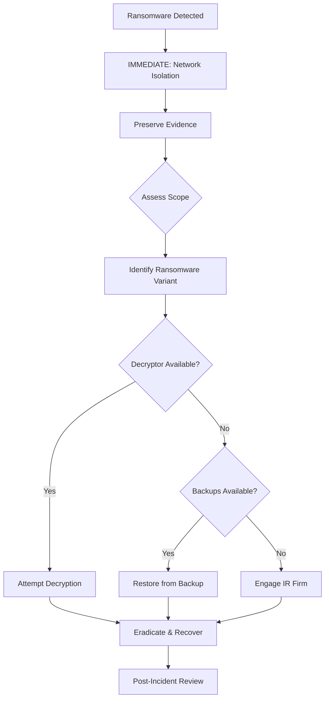

# IR-003: Ransomware Response Playbook

| Field | Value |
|-------|-------|
| **Playbook ID** | IR-003 |
| **Title** | Ransomware Incident Response |
| **Severity** | **CRITICAL** |
| **Author** | Omar Alraas |
| **Last Updated** | 2026-10-25 |
| **MITRE ATT&CK** | T1486 (Data Encrypted for Impact), T1490 (Inhibit Recovery) |

## ⚠️ CRITICAL: Immediate Actions (First 15 Minutes)

> **DO NOT** restart infected systems - this may destroy decryption keys in memory.
> **DO NOT** pay the ransom without consulting leadership and legal.
> **DO** isolate affected systems from the network IMMEDIATELY.

### Emergency Containment Checklist
- [ ] **IMMEDIATELY** disconnect affected hosts from network
- [ ] Disable Wi-Fi and Bluetooth on affected devices
- [ ] Block all SMB traffic (port 445) between VLANs at pfSense
- [ ] Preserve a memory dump of the infected host if possible
- [ ] Document the ransom note (screenshot, do not interact)

## Detection Sources
- Wazuh custom rules: 100132 (shadow copy / backup destruction), 100133 / 100134 (burst of files
  written with encrypted extensions by one process), 100126 (Defender disabled)
- Sigma: `shadow_copy_deletion`, `disable_windows_defender`
- YARA: ransomware_indicators.yar matches
- Suricata: C2 beaconing alerts
- File integrity monitoring (FIM): Rapid file changes

## Response Flow

## Phase 1: Identification & Scope Assessment

- [ ] Identify the ransomware variant (check ransom note, encrypted file extension)
- [ ] Search ID Ransomware (https://id-ransomware.malwarehunterteam.com/)
- [ ] Determine infection vector (phishing email, exploit, RDP compromise)
- [ ] Map all affected systems using Wazuh FIM alerts
- [ ] Check for data exfiltration (double extortion)

## Phase 2: Containment

- [ ] Network isolation of all affected systems
- [ ] Block C2 infrastructure at firewall level
- [ ] Disable compromised accounts
- [ ] Verify backup integrity (ensure backups are not encrypted)
- [ ] Isolate backup systems from the network

## Phase 3: Eradication

- [ ] Check for free decryptors at nomoreransom.org
- [ ] Remove all ransomware artifacts and persistence mechanisms
- [ ] Scan all systems for dormant malware
- [ ] Patch the initial infection vector

## Phase 4: Recovery

- [ ] Restore systems from verified clean backups
- [ ] Rebuild systems that cannot be restored
- [ ] Gradually restore network connectivity
- [ ] Implement enhanced monitoring for 30 days
- [ ] Reset ALL passwords (domain-wide if Active Directory compromised)

## Phase 5: Lessons Learned

- [ ] Complete post-incident report within 5 business days
- [ ] Update backup strategy (3-2-1 rule: 3 copies, 2 media types, 1 offsite)
- [ ] Implement additional controls (EDR, application whitelisting)
- [ ] Conduct user awareness training on phishing
- [ ] Test incident response plan quarterly

## Communication Plan

| Audience | When | Who Communicates |
|----------|------|-----------------|
| SOC Team | Immediate | Incident Lead |
| IT Management | Within 1 hour | SOC Manager |
| Executive Team | Within 4 hours | IT Director |
| Legal/Compliance | Within 24 hours | IT Director + Legal |
| Affected Users | After containment | IT Communications |
